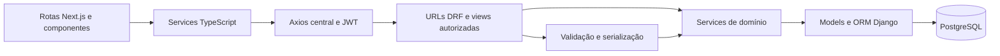

# Arquitetura implementada e direção de evolução

Inspeção de 12/10/2026. Versões declaradas: Django 5.2.14, DRF 3.17.1, Simple JWT 5.5.1; Next.js 16.2.6, React 19.2.4, TypeScript 5. Consulte requirements, package e lockfile antes de alterações.

## Organização

Monólito Django modular por domínio, API REST versionada e frontend Next.js separado. PostgreSQL persiste dados; arquivos têm storage conforme domínio. Nginx/Gunicorn/systemd compõem a operação prevista. Não introduzir microserviços, repository genérico, outro framework ou state manager apenas para uma tarefa local.

O diagrama descreve o fluxo preferido. Há gravações simples e validações nos serializers/views existentes; extraia fluxos complexos incrementalmente, sem reescrever apps para uniformizar tudo.

## Backend

- `config/settings.py`: configuração por ambiente; `config/urls.py`: composição de `/api/v1/` e `/django-admin/`.
- `apps/<dominio>/models.py`: entidades, relações e invariantes persistentes.
- `serializers.py`: campos explícitos, entrada/saída e validação estrutural.
- `views.py` e `urls.py`: HTTP, autorização, queryset acessível e ações de domínio.
- `services.py` ou `services/`: regras reutilizáveis, transações e efeitos relacionados. Preserve o formato existente do app.
- `migrations/`, `management/commands/`, `tests.py`: evolução de schema, rotinas operacionais e regressão.

Autorização combina papel, participação em grupo e produto ativo, conforme endpoint. `User` concentra helpers de papel; não há obrigação de criar um arquivo global de permissões. `PlayerGroup.players` usa perfis e `mediators` usa usuários. Relações recebidas no payload também precisam de validação de acesso.

## Frontend

- `src/app`: App Router, rotas públicas, admin e player; páginas compõem apresentação e estado de interação.
- `src/components`: layouts, proteção, modais, onboarding, legal, PWA e componentes de domínio.
- `src/services`: HTTP tipado por domínio via `src/lib/api.ts`.
- `src/types`: entidades e payloads; preserve formato real do serializer.
- `src/lib/auth.ts`: tokens e usuário no localStorage, helpers de papéis/produtos.
- CSS Modules: apresentação local; `globals.css`: reset e tokens da identidade preto/dourado/branco.

Sessão baseada em localStorage exige código cliente para leitura. Axios acrescenta Bearer, coordena refresh concorrente e tenta novamente a requisição; falha de refresh encerra a sessão. Server Components não têm acesso a esse armazenamento. Qualquer migração para cookies exige projeto próprio de autenticação.

## Compatibilidade e evolução

`Game` continua execução de um grupo; `Journey`/etapas/matrículas agregam jogos sem substituir sua API. Jornadas atuais geram três etapas de 21 dias; o modo diário usa `JourneyDay` e `DailyParticipation`, com calendário automático e registros privados, sem ligação obrigatória a Round. Ledgers separados e modalidades competitivas permanecem no backlog. Consulte `docs/DAILY_JOURNEY.md` a partir da raiz.

Mudanças em banco precisam de migration nova, análise de dados existentes e tests de invariantes. Operações de pontuação/revisão precisam de atomicidade e proteção contra repetição. Não introduzir transição automática, cron, filas ou integrações sem definir a regra e a operação.

Produção usa API relativa `/api/v1`; frontend ocupa `/admin/...`, Django Admin `/django-admin/`. PWA mantém cache somente da página offline, sem API ou conteúdo privado. Deploy documentado não representa deploy homologado.
